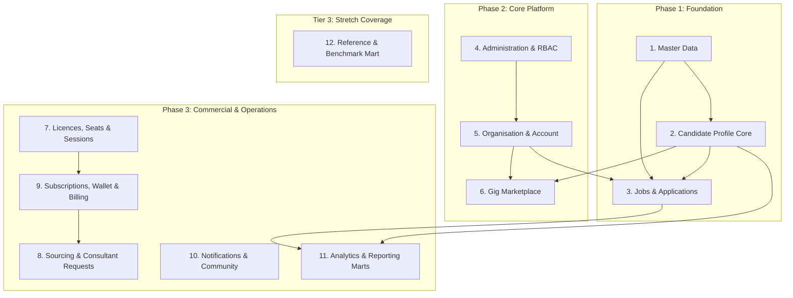

# Talentra Database Architecture & Foundational Decisions
**Platform**: Talentra (Job Search & Demand Management Platform)  
**Authoring Body**: Architecture & Data Engineering Team  
**Docket Reference**: Northbridge Workforce Systems Hackathon Specification (Phases 1–5, Backlogs B1–B23)

---

## 1. Milestone 1: DB Provider Decision (Backlog B1)

### Decision
We have selected **MySQL Server 8.0 (Enterprise/Community InnoDB engine)** as the operational and analytical database engine for Talentra.

### Technical Justification & Trade-Off Analysis

| Dimension | Architectural Evaluation & Justification |
| :--- | :--- |
| **Engine & Storage** | **MySQL 8.0 InnoDB Engine** provides ACID compliance, row-level locking (`SELECT ... FOR UPDATE`), crash recovery via write-ahead logging (redo log), MVCC (Multi-Version Concurrency Control), and clustered B+Tree indexes. Primary key lookups achieve near O(1) performance as table data is physically organized along the primary key index. |
| **Scale & Index Density** | At 100,000,000 application rows and 10,000,000 candidate profiles, memory footprint and buffer pool efficiency (`innodb_buffer_pool_size`) are paramount. Using compact 64-bit `BIGINT UNSIGNED` primary keys yields 8-byte pointers in non-clustered secondary indexes (compared to 16 bytes for UUIDs or variable-length text), maximizing index cache residency and minimizing page splits. |
| **Check Constraints** | MySQL 8.0.16+ natively parses and enforces table-level and column-level `CHECK` constraints (e.g., `end_date >= start_date`, `min_salary <= max_salary`, `max_devices > 0`), ensuring relational integrity directly in the storage engine without relying purely on application validation. |
| **Temporal Exclusion & Range Overlaps** | *Engine Trade-off*: Unlike PostgreSQL's `EXCLUDE USING gist`, MySQL lacks native spatio-temporal exclusion constraints. **Solution**: We implement deterministic `BEFORE INSERT` and `BEFORE UPDATE` database triggers with transactional verification (`SELECT 1 ... FOR UPDATE`) to strictly disallow overlapping gig booking windows (`gig_assignment`) and overlapping active subscription intervals (`subscription_period`). |
| **Partitioning Strategy** | InnoDB native range and list partitioning is leveraged on high-volume tables (`job_application`, `notification_delivery`, `audit_log`, `fact_application_event`), allowing partition pruning on timestamps and geographic/status boundaries. |
| **Character Set & Localization** | Standardized strictly on `utf8mb4` with collation `utf8mb4_0900_ai_ci` end-to-end, supporting full Unicode scripts, diacritics, multilingual names, and emojis. |
| **JSON & Semi-Structured Data** | Native `JSON` data type with binary storage, JSON validation functions, and functional indexes on virtual generated columns (`CAST(metadata->>'$.attribute' AS CHAR(50))`) for extensible questionnaire responses and audit event snapshots. |

---

## 2. Milestone 1: Agreed Module List & Scope Breakdown (Backlog B2)

The Talentra platform is partitioned into **11 Modular Subsystems** across three delivery phases, complemented by an **Optional Stretch Module (Tier 3)**:

### Module Scope Inventory

1. **Master Data (`sql/01_master_data.sql`)**: ISO country codes, states, cities, hierarchical taxonomy for skills, educational degree qualifications, industries, job functional roles, employment types, work modes, and the centralized UI localization translation catalog (`ui_translation`).
2. **Administration & RBAC (`sql/02_administration_and_rbac.sql`)**: Central user accounts (`app_user`), password hashes & salts, role definitions (`role_definition`), granular permissions (`app_permission`), role-permission mappings, consent logs (GDPR/DPDP), immutable append-only audit trail (`audit_log`), and candidate-to-company/recruiter privacy blocking tables (`privacy_block_entry`).
3. **Organisation & Account (`sql/03_organisation_and_account.sql`)**: Corporate entities (`organisation`), parent-subsidiary corporate hierarchy, corporate verification status, official tax identifiers (CIN, GSTIN, EIN), physical office locations (`office_location`), account administrators, and effective-dated recruiter assignments (`recruiter_assignment`).
4. **Candidate Profile (`sql/04_candidate_profile.sql`)**: Personal identity, verified E.164 contact records, educational histories (`candidate_education`), professional work experiences (`candidate_work_experience`), candidate skill associations with self/verified proficiencies, structured resume versions, profile projects, psychometric & coding assessments, course enrollments, profile completion score engine, profile view audits, and employer bookmarking.
5. **Jobs & Applications (`sql/05_jobs_and_applications.sql`)**: Requisition lifecycle (`job_requirement`), headcount management, publishing state machine, screening questionnaires with scoring weights, multi-stage application pipeline (`applied`, `shortlisted`, `interviewed`, `offered`, `joined`, `rejected`), interview rounds, and candidate application event timeline.
6. **Gig Marketplace (`sql/06_gig_marketplace.sql`)**: Specialized gig requests (`gig_request`) with fixed/hourly milestone pricing, gig worker independent profiles (`gig_worker_profile`), calendar availability windows (`gig_availability`), gig applications, accepted assignments with external handoff identifiers, client-to-freelancer ratings, favourite rosters, and freelancer blacklists.
7. **Licences, Seats & Sessions (`sql/07_licences_seats_devices.sql`)**: Commercial subscription licences (`subscription_licence`), user seat assignments, device-per-user quota limits, active device registration (`user_device`), concurrent login session ledger (`user_session`), and auditable session revocation workflows.
8. **Sourcing & Consultant Requests (`sql/08_sourcing_and_consultants.sql`)**: Requisition openness flags for external agency consultants, employer-consultant engagement requests, commission acceptance/rejections, bulk outreach campaigns, and candidate sourcing shortlists.
9. **Subscriptions, Wallet & Billing (`sql/09_subscriptions_wallet_billing.sql`)**: Commercial tier plans (`subscription_plan`), non-overlapping billing periods (`subscription_period`), double-entry immutable wallet balances (`wallet_account`) and transactions (`wallet_transaction`), payment gateway orders, tax invoices, refunds, and pay-per-download audit tracking (`candidate_profile_download_history`).
10. **Notifications, Preferences & Community (`sql/10_notifications_and_community.sql`)**: Multi-channel notification delivery queue (Email, SMS, Push, WhatsApp), user alert preferences, language and privacy flags, peer-to-peer community forum posts, reactions, helpdesk support tickets, and system FAQs.
11. **Analytics & Reporting Marts (`sql/11_analytics_reporting_marts.sql`)**: Kimball-style dimensional star schema: conformed dimensions (`dim_time`, `dim_job`, `dim_candidate`, `dim_organisation`, `dim_skill`), event facts (`fact_application_event`, `fact_wallet_transaction`), and pre-aggregated KPI cubes (`agg_monthly_hiring_funnel`, `agg_gig_fulfilment_kpis`).
12. **Stretch Module - Reference & Benchmarks (`sql/11_analytics_reporting_marts.sql`)**: Industry salary benchmarks by experience and role, employer peer ratings, trending job skill demand snapshots, and feature flags.

---

## 3. Milestone 1: Common Module Assignment (Backlog B3)

* **Common Foundation (All Team Members)**:
  * Master Data Taxonomy (`sql/01_master_data.sql`)
  * Candidate Profile Domain (`sql/04_candidate_profile.sql`)
  * Jobs & Applications Pipeline (`sql/05_jobs_and_applications.sql`)
* **Individual Workstream A**:
  * Administration & RBAC (`sql/02_administration_and_rbac.sql`)
  * Licences, Seats, Devices & Sessions (`sql/07_licences_seats_devices.sql`)
* **Individual Workstream B**:
  * Organisation & Account Hierarchy (`sql/03_organisation_and_account.sql`)
  * Sourcing & Consultant Engagement (`sql/08_sourcing_and_consultants.sql`)
* **Individual Workstream C**:
  * Gig Marketplace Subsystem (`sql/06_gig_marketplace.sql`)
  * Subscriptions, Wallet & Billing (`sql/09_subscriptions_wallet_billing.sql`)
  * Notifications, Community & Analytics Mart (`sql/10_notifications_and_community.sql`, `sql/11_analytics_reporting_marts.sql`)

---

## 4. Architectural Trade-Off: Gig Work vs Core Job Model

### Requirement (Section 2)
> *"Your design must decide whether gigs share the core job and application model with other job types, or sit in a separate subsystem. You must justify the decision, including the trade-offs for reporting, integrity, and future change."*

### Architectural Decision: Dedicated Gig Subsystem with Shared Master Data Core

We evaluated two architectural patterns:
1. **Option A: Polymorphic Unified Model** (Storing full-time jobs, contracts, and gig requests inside a single `job_requirement` table with nullable columns).
2. **Option B: Dedicated Gig Subsystem** (Separate `gig_request`, `gig_worker_profile`, `gig_application`, `gig_assignment` tables sharing foundational `app_user`, `organisation`, `skill`, `location`, and `wallet` tables).

We decisively chose **Option B (Dedicated Subsystem)**.

### Comparative Trade-Off Defense

| Evaluation Metric | Option A: Unified Polymorphic Model | Option B: Dedicated Gig Subsystem (Chosen) |
| :--- | :--- | :--- |
| **Data Integrity & Constraints** | **Poor**. Gigs require mandatory start/end timestamp windows, fixed or hourly budgets, max milestone durations, external handoff reference keys, and strict worker rating structures. In a unified table, 40% of columns are nullable for full-time roles, requiring complex conditional constraints. | **Superior**. 100% of gig-specific business rules (`end_window >= start_window`, `charge_rate > 0`, non-overlapping worker bookings) are enforced via strict NOT NULL columns, foreign keys, and targeted triggers. |
| **Lifecycle State Machine** | **Fragile**. Full-time jobs follow: `Draft -> Open -> Screening -> Interviews -> Offer -> Joined`. Gigs follow: `Broadcast -> Worker Bid/Apply -> Accept/Reject -> External Fulfilment Handoff -> Completed -> Rated`. Merging these lifecycles corrupts state transitions. | **Clean**. Independent lifecycle state machines. The gig assignment explicitly tracks external fulfillment integration status (`PENDING_HANDOFF`, `IN_FULFILMENT`, `RECONCILED`, `DISPUTED`). |
| **Reporting & Analytical Performance** | **Compromised**. Running high-frequency gig dispatch queries scans giant indexes polluted with millions of inactive full-time job requisitions, causing index cache churn. | **Optimized**. Transactional queries for gig availability and immediate matching run on lean, targeted indexes. Unified reporting across all workforce types is achieved seamlessly in the dimensional analytics layer (`dim_job` and `fact_application_event`). |
| **Future Schema Evolution** | **High Risk**. Evolving gig rules (e.g., escrow milestone releases, instant shift clock-ins) risks breaking core enterprise ATS workflows and recruiter permissions. | **High Decoupling**. The gig marketplace can iterate and scale independently without touching enterprise full-time requisition structures. |

---

## 5. Primary Key Strategy (Rule Group 2)

* **Internal Surrogate Keys**: `id BIGINT UNSIGNED NOT NULL AUTO_INCREMENT PRIMARY KEY`.
  * Guarantees 8-byte dense clustered index tree nodes.
  * Eliminates B+Tree secondary index page bloat at 100,000,000 rows.
  * Extremely fast integer joins for foreign keys.
* **External Public Identifiers**: `uuid CHAR(36) NOT NULL UNIQUE`.
  * Generated via `UUID()` / application UUIDv4.
  * Prevents sequential enumeration attacks on public API endpoints and URLs.

---

## 6. Concurrency, Device Limits & Session Security (Rule Group 9)

* **Rule**: A user cannot hold more active sessions than the maximum devices allowed by their corporate licence (`max_devices_per_user`).
* **Enforcement Mechanism**:
  1. Login requests invoke a stored procedure `sp_authenticate_and_open_session`.
  2. The procedure performs `SELECT COUNT(*) FROM user_session WHERE user_id = p_user_id AND is_active = 1 FOR UPDATE`.
  3. If active sessions >= licence limit, the procedure rejects the new login and writes an auditable security breach record to `audit_log` (`action = 'DEVICE_LIMIT_EXCEEDED'`).
  4. Session termination explicitly marks `is_active = 0` and sets `ended_at = NOW(6)`. Expired sessions (based on inactivity threshold) are flagged inactive via an automated scheduled event.

---

## 7. Organization Sub-Roles Extensibility Note (Section 3)

* **Current Hackathon Scope**: Employer organization privileges are enforced at the organization level: an employer or mapped recruiter may only view and act on job requisitions belonging to their assigned company (`organisation_id`).
* **Future Sub-Role Extension Design**:
  * An intermediate join table `organisation_member_role` will map `(organisation_id, user_id, org_sub_role_code)`.
  * Granular sub-roles: `REQUISITION_POSTER`, `RESUME_SCREENER`, `INTERVIEW_COORDINATOR`, `HIRING_MANAGER`, `OFFER_APPROVER`.
  * Requisition pipeline stages will bind to specific sub-role permission bits, allowing scoped access without modifying primary core table schemas.

---

## 8. Data Retention, Soft Deletion & Audit Lifecycle (Rule Group 4)

* **Soft Deletion (`deleted_at DATETIME(6) NULL`)**: Applied to business master entities (`app_user`, `organisation`, `candidate_profile`, `job_requirement`, `gig_request`). Soft-deleted records are automatically filtered from default operational views.
* **Hard Deletion**: Restricted solely to transient non-audit staging data.
* **Immutable Append-Only Records**: `audit_log`, `wallet_transaction`, `payment_order`, `candidate_profile_download_history`, and `candidate_profile_view_history`. Triggers prevent any `UPDATE` or `DELETE` statements on these tables.
* **Candidate GDPR/DPDP Right to be Forgotten**: Upon formal request, candidate identifiable fields (names, emails, phone numbers, tax IDs) are cryptographically scrubbed and overwritten with SHA-256 pseudonymized hashes, preserving historical referential integrity in analytics without retaining personal identifiers.
