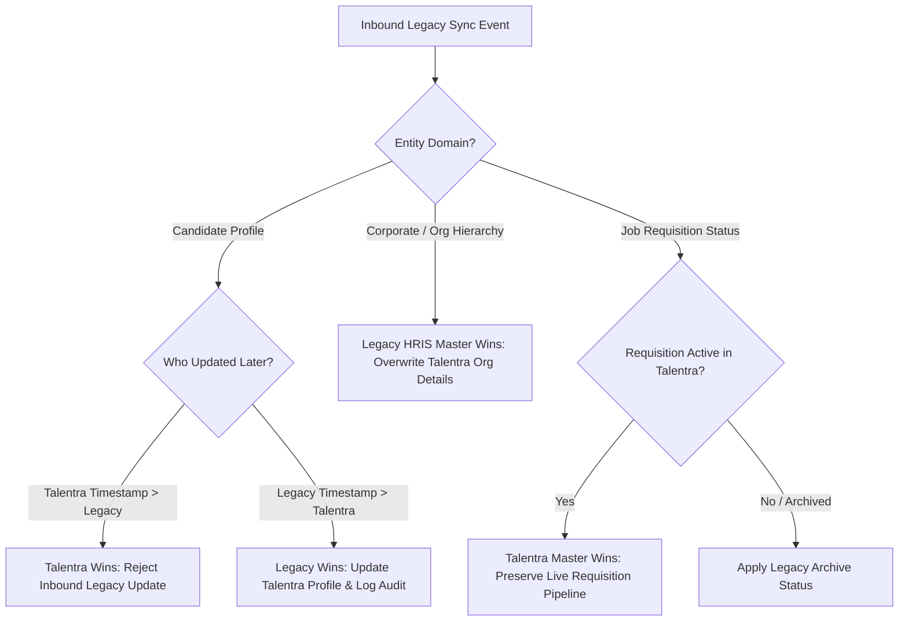

# Talentra Integration Boundaries & External Systems Architecture
**Docket Reference**: Section 6 (Integration Boundaries & Environment Sizing)

The Talentra platform interfaces with multiple external systems without owning their private operational workflows. For each integration boundary, the architectural ownership, stored vs referenced data, failure handling, idempotency mechanisms, and audit logging are strictly defined below.

---

## 1. Master Integration Boundaries Matrix

| Boundary | Data Ownership | Stored vs Referenced Data | Failure Behavior (Degradation / Outage) | Idempotency Mechanism | Audit Trail Implementation |
| :--- | :--- | :--- | :--- | :--- | :--- |
| **1. Payment Gateway** (Stripe / Razorpay / Adyen) | **External Gateway** is the authoritative source of truth for payment settlements, card lifecycle, and merchant funds transfer. | **Stored**: Gateway payment reference ID, payment order ID, currency, amount, settlement status (`AUTHORIZED`, `CAPTURED`, `FAILED`, `REFUNDED`), and timestamp. **Referenced**: Card numbers, CVV, bank account numbers, 3DS authentication tokens (NEVER stored). | **Queue & Webhook Reconciliation**: Asynchronous webhook processing with exponential backoff retry. Transaction marked `PENDING_PAYMENT` with a 30-minute expiry window. If down, user checkout shows friendly graceful degradation; no card data touches Talentra servers. | Deterministic `idempotency_key` (UUIDv4) generated per transaction attempt; gateway unique constraint on `(gateway_provider, transaction_reference)`. | Every gateway callback and webhook payload is logged in `payment_webhook_audit` with signature validation, raw body hash, and IP address. |
| **2. Identity Verification Service** (DigiLocker / Aadhaar / Trulioo) | **External Identity Authority** is the source of truth for official citizen identity, biometric authenticity, and document validity. | **Stored**: Verification status (`VERIFIED`, `REJECTED`, `EXPIRED`), verification token/reference, timestamp, and document type. **Referenced**: Cleartext national identification numbers (e.g., SSN, Aadhaar number) are NEVER stored in clear text. Only an HMAC-SHA256 salted hash is stored for deduplication. | **Asynchronous Fallback**: Candidate profile shows `VERIFICATION_PENDING`. Candidate can continue building profile and applying for non-gated jobs. Profile badge updates asynchronously when provider restores. | Re-verification requests require a unique nonce generated per session; provider callbacks use signed cryptographic webhooks. | Stored in `candidate_verification_audit` containing verification actor ID, provider transaction UUID, timestamp, and verification outcome. |
| **3. Company Registration & Tax Verification** (MCA / GSTN / IRS / SEC) | **Government / Corporate Registry** is authoritative for corporate legal status, active incorporation, and tax standing. | **Stored**: Verification status (`ACTIVE`, `SUSPENDED`, `DEREGISTERED`), registration date, masked tax identifier (e.g., GSTIN `27AAAAA0000A1Z5`), and official legal entity name. **Referenced**: Detailed financial tax returns, proprietary filings, and private corporate tax forms. | **Grace Period Processing**: Employer account placed in `PROVISIONAL_VERIFICATION` status for up to 72 hours, allowing job requisition drafting while restricting public broadcast until verification resolves. | Verification requests keyed on `(tax_identifier_type, tax_identifier_hash)`. Cached verification response with a 30-day Time-To-Live (TTL). | Recorded in `organisation_verification_audit` recording admin approver, verification agency response code, and timestamp. |
| **4. Gig Fulfilment System** (Field Force Management / Work Order System) | **External Fulfilment System** is authoritative for field milestone completion, dispatch tracking, GPS check-in/out, and contractor time sheets. | **Stored**: External handoff reference UUID, fulfillment milestone status (`DISPATCHED`, `IN_PROGRESS`, `FULFILLED`, `DISPUTED`), and reconciled earnings amounts (`estimated_earnings`, `reconciled_earnings`). **Referenced**: Live contractor GPS tracks, granular telemetry, and device battery/connectivity logs. | **State Buffering**: Talentra caches the last confirmed state. If fulfilment service is unreachable, gig worker status displays `DISPATCHED_PENDING_SYNC`. Earnings reconciliation runs in nightly batch reconciliation job. | Handoff UUID created by Talentra acts as the immutable foreign correlation key across systems. All webhook status transitions enforce strict monotonic state sequencing. | All handoff transmissions and milestone reconciliations logged in `gig_fulfilment_sync_log`. |
| **5. Legacy Job & Candidate Systems** (Northbridge Legacy ATS & HRIS) | **Bidirectional with Clear Domain Mastership**: Legacy HRIS is master for historical candidates and enterprise organizational units; Talentra is master for new applications, live gig requisitions, and digital assessments. | **Stored**: Legacy candidate profile ID (`legacy_source_id`), legacy requisition ID, migration batch ID, and legacy synchronization timestamp. **Referenced**: Deprecated legacy application logs, decommissioned binary resume attachments. | **Circuit Breaker & Staging Buffer**: Synchronization tasks run through a dead-letter queue (DLQ) with circuit breakers. If legacy database is locked or slow, delta sync pauses without blocking Talentra transactions. | Source record UUID plus version timestamp. Conflict rule: **Talentra timestamp wins for candidate updates; Legacy HRIS wins for corporate hierarchy updates**. | Dedicated `legacy_migration_sync_audit` capturing source table, target entity ID, sync action (`INSERT`, `UPDATE`, `CONFLICT_RESOLVED`), and payload diff. |
| **6. Messaging & Notification Providers** (SendGrid / Twilio / Firebase Cloud Messaging) | **Notification Delivery Provider** is authoritative for downstream network delivery, carrier receipts, bounce records, and spam complaints. | **Stored**: Provider message delivery ID, channel type (`EMAIL`, `SMS`, `PUSH`, `WHATSAPP`), delivery status (`QUEUED`, `DELIVERED`, `BOUNCED`, `REJECTED`), and delivery timestamp. **Referenced**: Full email/SMS message body discarded after 7 days; only message template code and parameter payload retained for compliance. | **Outbox Pattern & Multi-Provider Failover**: Messages written to local database outbox table (`notification_delivery`). Background worker dispatches messages. If primary SMS gateway fails, worker automatically retries via secondary provider. | Deterministic `idempotency_key` based on `SHA256(recipient_id + template_id + trigger_event_id + calendar_date)`. Prevents duplicate SMS/email sends on worker restarts. | Every provider delivery status change is logged in `notification_delivery_audit`. |
| **7. Social Sharing** (LinkedIn / X / WhatsApp Outbound Sharing) | **External Social Platforms** own the public feed, timeline interactions, comments, and public sharing permissions. | **Stored**: Outbound share event record (`share_channel`, `job_requirement_id`, `actor_user_id`, `shared_at`). **Referenced**: External post IDs, public impressions, retweets, external comments, or profile clicks on external networks (not owned or scraped). | **Fail-Safe Fire & Forget**: Social sharing uses standard client-side URI schemes (`https://www.linkedin.com/sharing/share-offsite/?url=...`). If external site is unreachable, no Talentra operational workflow is impacted. | Not applicable (client-side intent triggers unique share click event). | Logged in `social_share_event` table for candidate engagement metrics and attribution reporting. |
| **8. Mapping & Geolocation Service** (Google Maps / OpenStreetMap / Mapbox) | **Mapping Provider** is authoritative for global spatial polygons, street address geometries, reverse geocoding, and routing distances. | **Stored**: Decimal coordinates (`latitude DECIMAL(10,8)`, `longitude DECIMAL(11,8)`), geocoding precision level (`ROOFTOP`, `INTERPOLATED`, `APPROXIMATE`), provider place ID, and formatted address string. **Referenced**: Live tile layers, vector route polygons, transit travel times. | **Graceful Spatial Degradation**: Coordinates are treated as optional enrichment. If geolocation service is unreachable, address is saved as structured text (`city`, `state`, `postal_code`, `country`), and a background task queues geocoding. | Addresses normalized before hashing: `MD5(normalized_address_string)` used to cache geocoding lookups, minimizing external API costs. | Provider lookup errors and cache misses logged in `geolocation_api_audit`. |
| **9. Company Review & Salary Data** (Glassdoor / AmbitionBox / Payscale API) | **Review Aggregator** owns community review guidelines, moderation flags, reviewer anonymity, and proprietary salary percentile curves. | **Stored**: Reference attribution source name, aggregated rating average (e.g. `4.2 / 5.0`), review count snapshot, percentile benchmarks (`p25`, `p50`, `p75`), and refresh timestamp. **Referenced**: Individual user comments, private reviewer identities, unvetted employer grievances. | **Cached Stale-While-Revalidate**: Cached benchmark data displayed with explicit timestamp `"Source: Market Aggregates, Last Updated: Oct 2026"`. Service outage has zero impact on core posting or applying workflows. | Ingestion runs as an idempotent daily batch job keyed by `(organisation_id, job_role_id, calendar_year, calendar_quarter)`. | Ingestion runs and schema updates recorded in `salary_benchmark_refresh_log`. |

---

## 2. Synchronization Architecture & Conflict Resolution Rules

For legacy database interoperability (Boundary 5), the synchronization pipeline enforces deterministic conflict resolution:

