# Talentra: Complete Project & MySQL Database Schema Master Explainer
**Platform**: Talentra (Job Search & Demand Management Platform)  
**Engineering Body**: Northbridge Workforce Systems Hackathon Team  
**Target Engine**: MySQL Server 8.0+ (InnoDB Storage Engine, `utf8mb4`)  
**Target Scale**: Laptop Benchmark Scale (1M profiles / 100K jobs / 5M apps) $\rightarrow$ Full Scale (10M profiles / 1M jobs / 100M apps)

---

## 1. Project Overview & Business Mission

### 1.1 The Problem Statement
Northbridge Workforce Systems previously operated multiple disconnected legacy platforms holding candidate CVs, job requisitions, and recruitment histories in inconsistent, proprietary formats. This legacy fragmentation caused:
1. **Low Candidate Retention**: Candidates were forced to re-enter information across disjointed portals with no transparency into where their applications stood.
2. **Zero Unified Hiring Pipeline**: Employers had no single pane of glass to track talent across full-time corporate hiring, contract staffing, and on-demand project gigs.
3. **Severe Concurrency & Security Vulnerabilities**: Staffing agencies shared user logins across unmanaged laptops, leaking candidate PII and violating candidate privacy.
4. **Billing & Download Disputes**: Without append-only financial records, resume download credit deductions were prone to balance drift and audit disputes.

### 1.2 The Mission: Talentra
**Talentra** resolves these challenges by providing a unified, high-performance, strictly governed operational and analytical database. It serves six distinct platform actors:
* **Candidates**: Job seekers creating profiles, uploading versioned resumes, verifying skills, taking assessments, and setting privacy blocking rules against past or current employers.
* **Corporate Employers**: Enterprises posting requisitions, designing screening questionnaires, tracking multi-stage hiring pipelines, managing company locations, and holding subscription licences.
* **Internal Recruiters**: Assigned staff who source, screen, and interview candidates exclusively for their mapped employer organization.
* **Freelance Agency Consultants**: External recruiting partners granted permission to source talent on designated "consultant-open" requisitions.
* **Placement Officers (TPOs)**: College and university officers coordinating campus hiring drives.
* **Gig Workers & Requesters**: Freelancers and project managers transacting short-duration, rate-based gigs with calendar availability and external fulfillment reconciliation.
* **Platform Administrators**: Governance team enforcing RBAC permissions, monitoring device limits, and reviewing immutable audit logs.

---

## 2. Core Architectural Standards & The 10 Rule Groups

The database adheres strictly to the **10 Mandatory Rule Groups** defined in the project docket:

1. **Rule Group 1: Naming Conventions**:
   * All tables and columns use `snake_case`.
   * All table names are **strictly singular nouns** (`candidate_profile`, `job_requirement`, `gig_request`).
   * Primary keys are named `id`; foreign keys use `<referenced_table>_id` (e.g. `job_requirement_id`).
   * Zero engine reserved keywords used as identifiers (e.g. `app_user` instead of `user`, `role_definition` instead of `role`, `payment_order` instead of `order`, `lookup_key` instead of `key`).
   * Consistent naming prefixes: `idx_` for indexes, `uq_` for unique constraints, `dim_` for dimensions, `fact_` for facts, `agg_` for aggregate cubes, `v_` for views.
2. **Rule Group 2: Surrogate Keys & Constraints**:
   * Every entity has an internal 64-bit integer surrogate primary key: `id BIGINT UNSIGNED NOT NULL AUTO_INCREMENT PRIMARY KEY`.
   * Natural identifiers (tax IDs, emails) are enforced as unique constraints, not primary keys.
   * Every table has a companion `uuid CHAR(36) NOT NULL UNIQUE DEFAULT (UUID())` used as an opaque public identifier to prevent ID enumeration attacks in external APIs.
   * Engine-level `CHECK` constraints validate business logic directly in InnoDB (e.g. `max_salary >= min_salary`, `end_date >= start_date`, `max_devices > 0`).
3. **Rule Group 3: Standard Domains**:
   * Names: `VARCHAR(150)` UTF-8.
   * Emails: `VARCHAR(254)` lowercase with unique constraint.
   * Phone: E.164 format with separated country dial code (`country_dial_code VARCHAR(5)`, `national_phone_number VARCHAR(15)`).
   * Money: `DECIMAL(14,2)` fixed-precision paired with an ISO 4217 `currency_code CHAR(3)`. Floating-point types (`FLOAT`, `DOUBLE`) are strictly forbidden for currency.
   * Dates & Timestamps: Calendar dates in `DATE`; high-precision event times in UTC `DATETIME(6)`.
   * Enumerations: Backed by dedicated lookup tables with active flags and multilingual display names.
4. **Rule Group 4: Audit & Lifecycle**:
   * All business tables carry universal metadata: `created_at DATETIME(6)`, `created_by BIGINT UNSIGNED NULL`, `updated_at DATETIME(6)`, `updated_by BIGINT UNSIGNED NULL`.
   * Entities are explicitly classified into **soft-deleted** (`deleted_at DATETIME(6) NULL`) or **hard-deleted**.
   * Financial ledgers and audit records are **strictly append-only**.
5. **Rule Group 5: Nullability & Missing Data Governance**:
   * Every nullable column has an explicit business justification in the Data Dictionary.
   * Missing vs Not Applicable data are explicitly differentiated: candidates not disclosing salary have `salary_disclosure_status = 'UNDISCLOSED'` with `current_salary = NULL`. Unpaid internships use `'NOT_APPLICABLE'`.
   * Sentinel values (like `0`, `'NA'`, or empty strings `''`) are prohibited for missing values.
6. **Rule Group 6: Sensitive Data Classification**:
   * All columns are tagged: `[PUBLIC]`, `[INTERNAL]`, `[PERSONAL]`, or `[SENSITIVE]`.
   * Sensitive tax IDs are masked for display and hashed with salted HMAC-SHA256 for duplicate checks. Passwords use **Argon2id**.
7. **Rule Group 7: Multilingual Data**:
   * Full database initialized with `CHARACTER SET utf8mb4 COLLATE utf8mb4_0900_ai_ci`.
   * UI strings are stored by translation keys in `ui_translation` with fallback text.
8. **Rule Group 8: Physical Object Naming**:
   * Analytical objects prefixed with `dim_`, `fact_`, `agg_`. Views prefixed with `v_`.
9. **Rule Group 9: Licensing, Devices & Sessions**:
   * Max users and max devices per user stored as positive integers with check constraints.
   * Active sessions count cannot exceed licensed device quota; admission bounded at login.
10. **Rule Group 10: Money, Subscriptions & Ledgers**:
    * Double-entry append-only wallet ledger (`wallet_transaction`). Corrections issued via new compensating entries.
    * Database triggers disallow overlapping subscription periods and overlapping gig bookings.

---

## 3. High-Level Entity-Relationship Architecture

The diagram below illustrates how Talentra’s 11 modules connect into a unified ecosystem:

```mermaid
erDiagram
    app_user ||--o{ user_role_assignment : has
    role_definition ||--o{ user_role_assignment : assigned_to
    app_user ||--|| user_credential : authenticates_with
    app_user ||--o{ user_device : registers
    user_device ||--o{ user_session : opens
    
    app_user ||--o| candidate_profile : owns
    candidate_profile ||--o{ candidate_education : has
    candidate_profile ||--o{ candidate_work_experience : has
    candidate_profile ||--o{ candidate_skill : possesses
    candidate_profile ||--o{ candidate_resume : uploads
    candidate_profile ||--o{ candidate_assessment : takes
    
    organisation ||--o{ office_location : operates
    organisation ||--o{ organisation_verification : verifies_with
    organisation ||--o{ recruiter_assignment : maps
    app_user ||--o{ recruiter_assignment : acts_as
    organisation ||--|| wallet_account : owns
    wallet_account ||--o{ wallet_transaction : records_ledger
    organisation ||--o{ subscription_licence : holds
    subscription_licence ||--o{ subscription_period : billed_in
    
    organisation ||--o{ job_requirement : posts
    job_requirement ||--o{ job_requirement_skill : requires
    job_requirement ||--o| job_questionnaire : screens_with
    job_questionnaire ||--o{ job_question : contains
    
    job_requirement ||--o{ job_application : receives
    candidate_profile ||--o{ job_application : submits
    candidate_resume ||--o{ job_application : attaches
    job_application ||--o{ job_interview : schedules
    job_application ||--o{ job_application_status_history : tracks_stage
    
    app_user ||--o| gig_worker_profile : operates_as
    gig_worker_profile ||--o{ gig_availability : schedules
    organisation ||--o{ gig_request : posts
    gig_request ||--o{ gig_application : receives
    gig_worker_profile ||--o{ gig_application : bids
    gig_application ||--o| gig_assignment : fulfills
    gig_assignment ||--|| gig_earnings_reference : syncs_external
    gig_assignment ||--o| gig_rating : rated_by
    
    app_user ||--o{ privacy_block_entry : blocks_entities
```



---

## 4. Deep-Dive Walkthrough of the MySQL Schema (By Module)

The database consists of **94 base tables, views, stored procedures, and triggers** organized across 11 modules + Tier 3 stretch coverage:

### Module 1: Master Data & Taxonomies (`sql/01_master_data.sql`)
Provides canonical, normalized lookup entities to eliminate text redundancies across 100M rows:
* **`country`**: Canonical ISO 3166-1 alpha-2/alpha-3 country codes, international phone dial codes (`+91`, `+1`), and default currencies.
* **`state_province`**: Regional provinces mapped to countries (`country_id`).
* **`city`**: Municipalities with geographic latitude/longitude check constraints (`chk_city_coordinates`).
* **`spoken_language`**: ISO 639-1 language codes, native script names, and UI localization availability flags.
* **`ui_translation`**: Multilingual dictionary storing localized interface strings by `(translation_key, language_code)`. Guarantees fallback to English if a localized string is missing.
* **`skill_category` & `skill`**: Self-referencing hierarchical skill taxonomy (e.g. *Data & AI* $\rightarrow$ *Machine Learning* $\rightarrow$ *Deep Learning*). Includes trending flags (`is_trending`).
* **`educational_qualification`**: Standardized academic degrees (B.Tech, MBA, MCA, PhD) categorized by academic tier (`BACHELORS`, `MASTERS`, `DOCTORATE`).
* **`industry_sector` & `job_role`**: Industry taxonomy (BFSI, IT Services, Healthcare) mapped to standardized functional roles (Backend Systems Engineer, Data Scientist).
* **Lookups**: `employment_type_lookup`, `work_mode_lookup`, and `currency_code_lookup`.

---

### Module 2: Administration, Identity & RBAC (`sql/02_administration_and_rbac.sql`)
Establishes user identity, authentication, granular authorization, and compliance logs:
* **`app_user`**: Central user identity storing unique lowercase email, verified E.164 phone number, account status (`ACTIVE`, `SUSPENDED`), and brute-force lockout counters (`failed_login_count`, `locked_until`).
* **`user_credential`**: High-security authentication table storing salted **Argon2id** password hashes. Decoupled from `app_user` to prevent credential leakage in general user queries.
* **`role_definition`**: Canonical platform roles: `SUPER_ADMIN`, `ADMIN`, `ACCOUNT_ADMIN`, `GUEST`, `CANDIDATE`, `EMPLOYER`, `RECRUITER`, `CONSULTANT`, and `TPO`.
* **`app_permission` & `role_permission_mapping`**: Fine-grained RBAC permissions mapped to system roles.
* **`user_role_assignment`**: Maps users to one or more roles with activation timestamps.
* **`user_consent_record`**: Immutable consent tracker recording terms acceptance, privacy policy versions, user IP, and timestamp for GDPR and DPDP compliance.
* **`audit_log`**: Append-only event ledger capturing every sensitive action (`actor_user_id`, `action_type`, `pre_change_state`, `post_change_state`, IP, timestamp). Updates and deletions are actively blocked by triggers.
* **`privacy_block_entry`**: Candidate-driven anti-harassment registry. Allows candidates to block specific employer organizations or rogue recruiters.

---

### Module 3: Organisation, Accounts & Recruiter Mapping (`sql/03_organisation_and_account.sql`)
Models enterprise employers, legal verification, office locations, and tenant isolation:
* **`organisation`**: Corporate employer master record with legal name, commercial trade name, parent-subsidiary corporate hierarchy (`parent_organisation_id`), and verification status (`PENDING`, `PROVISIONAL`, `VERIFIED`).
* **`office_location`**: Physical corporate locations and regional hubs tied to cities with headquarters flags (`is_headquarters`).
* **`organisation_verification`**: Official legal identifiers (CIN, GSTIN, EIN). Cleartext numbers are masked for UI display (`identifier_value_masked`), while an HMAC-SHA256 salted hash (`identifier_hash`) prevents duplicate registration attempts without exposing raw tax numbers.
* **`account_administrator`**: Multi-admin corporate governance mapping user accounts to ownership tiers (`PRIMARY_ADMIN`, `BILLING_ADMIN`, `HR_ADMIN`).
* **`recruiter_assignment`**: **Effective-dated recruiter mapping**. Enforces the core business rule that internal recruiters can only view and act on job requisitions belonging to their assigned company. Contains date constraints: `CHECK (effective_to_date IS NULL OR effective_to_date >= effective_from_date)`.

---

### Module 4: Candidate Profile Core & Lifecycle (`sql/04_candidate_profile.sql`)
Models the rich multi-dimensional resume of candidate job seekers:
* **`candidate_profile`**: Candidate identity record containing first name, optional last name (mononym support), total experience in months, notice period days, profile completion percentage, and explicit salary disclosure flags (`salary_disclosure_status` = `DISCLOSED`, `UNDISCLOSED`, or `NOT_APPLICABLE`).
* **`candidate_education`**: Academic history linked to `educational_qualification`, with graduation year check constraints (`chk_ce_years`).
* **`candidate_work_experience`**: Professional employment history with start/end date validation (`chk_cwe_dates`). A `NULL` end date designates the current active role.
* **`candidate_skill`**: Skill associations tracking self-professed proficiency (`BEGINNER`, `INTERMEDIATE`, `ADVANCED`, `EXPERT`), experience duration, and a flag indicating whether the skill was verified through standardized proctored testing (`is_verified_by_test`).
* **`candidate_language`**: Spoken and written language proficiencies with read/write/speak capability flags.
* **`candidate_resume`**: Stores multiple CV versions per candidate with S3/cloud storage URIs, MIME types, raw text for ATS indexing, and template identifiers.
* **`candidate_project`**: Full-time and gig portfolio projects with descriptions, outcomes, and repository/live URLs.
* **`candidate_assessment`**: Standardized coding, aptitude, and psychometric test results with maximum scores and percentile ranks.
* **`candidate_course_enrolment`**: Professional certifications and issuing organizations with expiration dates.
* **`candidate_profile_view_history` & `candidate_activity_log`**: Append-only activity logs tracking who viewed a candidate's profile, candidate login events, and resume downloads.
* **`candidate_bookmark`**: Employer shortlists and bookmarks for saved candidate profiles.

---

### Module 5: Job Requirements & Applications Pipeline (`sql/05_jobs_and_applications.sql`)
Powers the core corporate recruiting funnel:
* **`job_requirement`**: Job requisition lifecycle record tracking title, description, positions authorized (`positions_count`), positions filled (`positions_filled_count`), salary bands, publish state (`DRAFT`, `PUBLISHED`, `PAUSED`, `CLOSED`), and external consultant authorization flag (`is_open_to_consultants`).
* **`job_requirement_skill`**: Connects required skills to job requisitions, specifying whether each skill is mandatory or optional.
* **`job_questionnaire` & `job_question`**: Interactive screening questionnaires attached to job requisitions. Supports single-choice, multi-choice, and knockout questions (`is_knockout = TRUE`). If a candidate fails a knockout question, their application is automatically rejected.
* **`job_application`**: **The central transaction table**. Connects a candidate and resume to a job requirement. Tracks the multi-stage hiring pipeline:
  $$\text{APPLIED} \longrightarrow \text{SHORTLISTED} \longrightarrow \text{INTERVIEWED} \longrightarrow \text{OFFERED} \longrightarrow \text{JOINED} \quad (\text{or } \text{REJECTED})$$
  Stores algorithmic match percentage scores and timestamps for stage transitions.
* **`job_questionnaire_response`**: Records candidate answers to screening questions with automated scoring.
* **`job_interview`**: Schedules interview rounds (`TECHNICAL_ROUND_1`, `BEHAVIORAL`, `MANAGERIAL`), linking interviewers, scheduled time windows, meeting links, and interviewer rating feedback.
* **`job_application_status_history`**: Append-only pipeline history recording every stage progression, changing user ID, reason notes, and timestamps.
* **`candidate_job_search_history`**: Records candidate search queries and applied filters for analytics.

---

### Module 6: Dedicated Gig Marketplace Subsystem (`sql/06_gig_marketplace.sql`)
Implements the on-demand workforce marketplace, cleanly isolated from full-time jobs:
* **`gig_worker_profile`**: Specialized contractor profile storing hourly charge rates, payout preferences, rolling customer rating averages, and instant availability flags.
* **`gig_availability`**: Granular calendar availability slots for gig workers with start/end time windows.
* **`gig_request`**: Project requisition carrying mandatory delivery start and end windows (`chk_gr_window`), pricing models (`FIXED_PRICE` vs `HOURLY_RATE`), budget amounts, and workers required.
* **`gig_application`**: Contractor applications. Bids flow unidirectionally from worker to requester; the requester accepts or rejects.
* **`gig_assignment`**: Represents accepted, scheduled gigs. Stores external fulfillment system correlation tokens (`external_handoff_reference_id`), scheduled delivery windows, and agreed payouts.
* **`gig_earnings_reference`**: External integration boundary tracking estimated, reconciled, and projected payouts sourced from third-party fulfillment services.
* **`gig_rating`**: Post-project client reviews capturing overall rating, code quality, and punctuality scores (1.0 to 5.0).
* **`gig_favorite_worker` & `gig_blacklist_worker`**: Employer rosters for prioritized contractor matching and organization-wide blacklisting.

---

### Module 7: Licences, Seats, Devices & Sessions (`sql/07_licences_seats_devices.sql`)
Enforces hardware binding and concurrency governance:
* **`subscription_licence`**: Enterprise corporate licence defining authorized seat quotas (`max_users`) and hardware device allowances per user (`max_devices_per_user`), protected by positive check constraints.
* **`licence_seat_allocation`**: Assigns licensed seats to active corporate users.
* **`user_device`**: Registers physical user hardware via SHA-256 device fingerprint hashes, device OS, and browser signatures.
* **`user_session`**: Tracks live authenticated sessions with start times, last activity heartbeats, end times, and IP addresses. Expired sessions are excluded from quota counts.
* **`session_revocation_event`**: Auditable event log capturing administrative and security session revocations.
* **`login_attempt_history`**: Audit trail of successful and failed logins used for rate-limiting and intrusion detection.

---

### Module 8: Sourcing & Consultant Requests (`sql/08_sourcing_and_consultants.sql`)
Governs third-party recruitment agencies and freelance headhunters:
* **`consultant_sourcing_request`**: Sourcing engagement contract linking a job requisition to an external consultant. Tracks agreed commission percentages and approval states (`PENDING`, `ACCEPTED`, `DECLINED`). Enforces that consultants can only engage with requisitions where `is_open_to_consultants = TRUE`.
* **`consultant_candidate_shortlist`**: Candidate submissions pitched by consultants for client review.
* **`bulk_outreach_batch` & `bulk_outreach_recipient`**: Bulk recruiter sourcing campaigns. Tracks credit deductions, campaign criteria, recipients reached, and candidate response statuses (`QUEUED`, `SENT`, `OPENED`, `RESPONDED`).

---

### Module 9: Subscriptions, Wallet & Billing (`sql/09_subscriptions_wallet_billing.sql`)
Guarantees financial integrity and commercial quota tracking:
* **`subscription_plan`**: Commercial pricing tiers (Starter, Growth, Enterprise) defining monthly/annual pricing and included monthly quotas for job postings, resume downloads, and outreach credits.
* **`subscription_period`**: Active billing intervals bound to a licence. **Non-overlapping validity periods** are enforced via database triggers.
* **`wallet_account`**: Pre-paid credit wallet per employer organization with check constraints preventing negative balances (`chk_wa_balance`).
* **`payment_order`**: Gateway payment transaction records (Stripe/Razorpay) carrying unique idempotency keys to prevent duplicate billing.
* **`wallet_transaction`**: **Double-entry, append-only financial ledger**. Credits (recharges) and debits (job postings, resume downloads, bulk outreach) are recorded as immutable rows. Database triggers prohibit `UPDATE` and `DELETE`. Ledger corrections are recorded as new compensating transactions referencing the original transaction ID.
* **`invoice_record`**: Formal GST/VAT tax invoices generated for completed payment orders.
* **`candidate_profile_download_history`**: Append-only commercial audit tracking which recruiter downloaded which candidate resume, the timestamp, and the exact credit units deducted.

---

### Module 10: Notifications, Preferences & Community (`sql/10_notifications_and_community.sql`)
High-volume delivery infrastructure and collaboration:
* **`user_preference`**: User-controlled notification channel toggles (Email, SMS, Push, WhatsApp), job alert frequencies, profile visibility rules (`PUBLIC`, `RECRUITERS_ONLY`, `ANONYMOUS`, `HIDDEN`), and UI language preferences.
* **`notification_delivery`**: **High-volume outbox queue**. Buffers outbound messages with unique idempotency keys, delivery statuses (`QUEUED`, `SENT`, `DELIVERED`, `BOUNCED`), and retry counts.
* **`community_post` & `community_reaction`**: Moderated peer discussion forum for career advice, interview preparation, and salary insights.
* **`support_ticket` & `platform_faq`**: Customer helpdesk ticketing system with priorities, categories, and resolution summaries, alongside self-service FAQs.

---

### Module 11: Analytics Reporting Marts & Dimensional Star Schema (`sql/11_analytics_reporting_marts.sql`)
Kimball-style dimensional model for executive reporting and KPI aggregation:
* **`dim_time`**: Conformed calendar dimension breaking dates into calendar year, quarter, month, week, day of week, weekend flags, and fiscal quarters.
* **`dim_job`**: Conformed job requisition dimension denormalizing role, industry, employment type, and work mode for fast aggregation.
* **`dim_candidate`**: Anonymized candidate dimension grouping profiles into experience tiers (`FRESHER`, `JUNIOR_1_3`, `MID_4_7`, `SENIOR_8_12`, `LEAD_13_PLUS`) and education levels without exposing direct contact PII.
* **`dim_organisation`**: Conformed employer dimension for corporate slicing.
* **`fact_application_event`**: Event fact table tracking every pipeline progression with boolean milestone indicators (`is_applied`, `is_shortlisted`, `is_interviewed`, `is_offered`, `is_joined`) and elapsed durations (`days_to_shortlist`, `days_to_offer`).
* **`fact_wallet_transaction`**: Financial fact table capturing revenue, recharges, and credit burn rates across time and organizations.
* **`agg_monthly_hiring_funnel`**: Pre-aggregated rollup mart calculating monthly recruitment conversion rates, average match scores, and average time-to-hire per employer and role.
* **`agg_gig_fulfilment_kpi`**: Pre-aggregated rollup mart tracking monthly gig demand, assignment completion rates, dispute volumes, and average contractor ratings per city.

---

### Module 12: Tier 3 Reference & Stretch Coverage (`sql/11_analytics_reporting_marts.sql`)
Advanced market intelligence features:
* **`salary_benchmark`**: Comprehensive market compensation percentiles (25th, 50th median, 75th, 90th percentile) broken down by job role, experience tier, and city. Enforces percentile ordering: `chk_sb_percentiles CHECK (p90 >= p75 AND p75 >= p50 AND p50 >= p25)`.
* **`organisation_rating_snapshot`**: Company review averages and culture/work-life scores sourced from verified employee benchmarks.
* **`trending_job_snapshot`**: Real-time labor market snapshots tracking active postings, candidate demand ratios, and month-over-month growth rates for trending skills.
* **`feature_flag`**: Dynamic system configuration table enabling zero-downtime feature switches and percentage rollouts.

---

## 5. Key Database-Level Architectural Mechanisms

The project docket requires that critical business rules are enforced **in the database storage layer**, not merely assumed in application code:

### 5.1 Candidate Privacy Blocking (Anti-Harassment Enforcement)
* **The Rule**: A candidate can block specific employers, recruiters, or consultants. Blocked parties must never discover or view that candidate.
* **Implementation**: Enforced in operational discovery views ([`v_candidate_discovery`](file:///c:/Users/prakr/Desktop/Job_Search_and_Demand_Management/sql/12_views_and_security_controls.sql)) and search queries via an index-backed `NOT EXISTS` anti-join probe:
```sql
SELECT cp.id, cp.display_name, c.city_name, jr.role_name
FROM candidate_profile cp
INNER JOIN app_user u ON cp.app_user_id = u.id
WHERE cp.deleted_at IS NULL AND cp.is_actively_looking = TRUE
  AND NOT EXISTS (
      SELECT 1 FROM privacy_block_entry pbe
      WHERE pbe.blocker_candidate_user_id = u.id
        AND pbe.is_active = TRUE
        AND ((pbe.blocked_entity_type = 'ORGANISATION' AND pbe.blocked_target_id = :viewing_org_id)
          OR (pbe.blocked_entity_type = 'RECRUITER_USER' AND pbe.blocked_target_id = :viewing_recruiter_id))
  );
```
* **Performance**: Backed by composite index `idx_privacy_block_search (blocked_entity_type, blocked_target_id, is_active)`, executing in **1.39 ms**.

---

### 5.2 Recruiter Multi-Tenancy Data Isolation
* **The Rule**: A recruiter may only view and act on job requisitions belonging to their own company.
* **Implementation**: Recruiter assignments in `recruiter_assignment` are effective-dated. The database view [`v_recruiter_job_feed`](file:///c:/Users/prakr/Desktop/Job_Search_and_Demand_Management/sql/12_views_and_security_controls.sql) strictly joins against the recruiter's active organization ID, preventing data leakage across competitor staffing agencies.

---

### 5.3 Active Session Concurrency & Device Limiting (Rule Group 9)
* **The Rule**: A user cannot hold more concurrent active sessions than their licence's `max_devices_per_user`.
* **Implementation**: Enforced via stored procedure `sp_authenticate_and_open_session`:
  1. The procedure reads the user's active corporate licence quota.
  2. It performs `SELECT COUNT(*) FROM user_session WHERE app_user_id = p_user_id AND is_active = TRUE AND session_end_time IS NULL FOR UPDATE` (pessimistic row locking).
  3. If active sessions $\ge$ quota, admission is denied, returning `DEVICE_LIMIT_EXCEEDED`, and an auditable security breach record is inserted into `audit_log`.
  4. If within quota, the hardware device fingerprint is registered in `user_device` and a new session is opened in `user_session`.

---

### 5.4 Append-Only Financial & Audit Immutability (Rule Group 4 & 10)
* **The Rule**: Ledger transactions and audit records must be strictly append-only.
* **Implementation**: Database triggers actively block mutations:
```sql
CREATE TRIGGER trg_wallet_transaction_prevent_update
BEFORE UPDATE ON wallet_transaction
FOR EACH ROW
BEGIN
    SIGNAL SQLSTATE '45000'
    SET MESSAGE_TEXT = 'Financial Integrity Violation: wallet_transaction is an append-only ledger.';
END;
```
Identical triggers guard `audit_log` and `candidate_profile_download_history`.

---

### 5.5 Temporal Non-Overlap Enforcement for Gigs and Subscriptions
* **The Rule**: Gig assignments cannot overlap for the same worker; subscription periods cannot overlap for the same licence.
* **Implementation**: Since MySQL lacks PostgreSQL's `EXCLUDE USING gist`, deterministic triggers (`trg_gig_assignment_prevent_overlap_insert` and `trg_subscription_period_prevent_overlap_insert`) perform interval checks before insertion:
```sql
SELECT COUNT(*) INTO overlap_count
FROM gig_assignment
WHERE gig_worker_profile_id = NEW.gig_worker_profile_id
  AND assignment_status_code IN ('ASSIGNED', 'IN_FULFILMENT')
  AND NEW.scheduled_start_time < scheduled_end_time
  AND NEW.scheduled_end_time > scheduled_start_time;

IF overlap_count > 0 THEN
    SIGNAL SQLSTATE '45000'
    SET MESSAGE_TEXT = 'Schedule Integrity Violation: Gig booking windows cannot overlap for the same worker.';
END IF;
```

---

## 6. Empirical Verification & Performance Evidence

The schema and operational scripts have been tested on live MySQL Server 8.0:

### 6.1 Benchmark Results for the 12 Core Queries (`scripts/run_benchmark.py`)
All 12 core workflow queries executed in **under 5 milliseconds**:

| Query ID & Core Workflow | Result Rows | Latency p50 | Latency p95 | Execution Plan Mechanism |
| :--- | :---: | :---: | :---: | :--- |
| **Q1: Candidate Search with Privacy Blocking** | 22 | **1.39 ms** | 2.25 ms | Range scan on `job_role_id` + Anti-Join probe |
| **Q2: Employer Hiring Pipeline Funnel Breakdown** | 14 | **2.69 ms** | 4.40 ms | Ref lookup on `organisation_id` + Stream Agg |
| **Q3: Multi-Skill Candidate Matching Algorithm** | 25 | **4.43 ms** | 5.11 ms | Clustered PK join + Temporary Table Agg |
| **Q4: Available Gig Worker Discovery** | 2 | **1.11 ms** | 1.55 ms | Index range scan on `(worker_id, window)` |
| **Q5: Active Device Concurrency Check** | 1 | **0.77 ms** | 1.11 ms | Primary key point lookup + Index ref |
| **Q6: Recruiter-Scoped Requisition Discovery** | 14 | **1.84 ms** | 2.05 ms | Covering index on `recruiter_assignment` |
| **Q7: Append-Only Wallet Ledger Reconciliation** | 1 | **0.58 ms** | 0.81 ms | Point lookup on `wallet_account_id` |
| **Q8: Gig External Fulfilment Reconciliation Status** | 10 | **0.75 ms** | 1.22 ms | Filtered range scan on `assignment_status` |
| **Q9: Notification Delivery Outbox Polling** | 10 | **0.70 ms** | 0.98 ms | Composite index `(delivery_status, queued_at)` |
| **Q10: Monthly Hiring Funnel & Time-to-Hire KPI** | 4 | **0.77 ms** | 1.20 ms | Index scan on `dim_time (calendar_year)` |
| **Q11: Candidate Profile Download Audit History** | 5 | **0.74 ms** | 1.04 ms | Ref scan on `downloader_organisation_id` |
| **Q12: Salary Percentile Benchmark Comparison** | 50 | **1.53 ms** | 2.34 ms | Ref lookup on `(job_role_id, city_id)` |

---

### 6.2 Disaster Recovery Benchmark (`scripts/backup_restore_test.py`)
* **Online Snapshot Backup**: **1.10 seconds** via `mysqldump` with `--single-transaction --quick --routines --triggers --events --hex-blob`.
* **Database Restore Time**: **5.72 seconds**.
* **Measured RTO**: **5.72 seconds** (far exceeding the 15-minute / 900-second hackathon SLA).
* **Data Parity Check**: **100% verified** across all 94 base tables with zero record loss.

---

## 7. How to Explain This Project to the Hackathon Panel (Summary)

When presenting to the judges, frame your pitch around these **three core differentiators**:

1. **Uncompromising Relational & Commercial Governance**:
   > *"Unlike common MVP designs that rely entirely on application code, Talentra enforces non-negotiable business rules directly in the MySQL storage engine: append-only wallet and audit triggers make tampering impossible, login stored procedures enforce active device limits with pessimistic locking, and candidate blocking rules guarantee candidate privacy at the SQL query level."*
2. **Dedicated Gig Subsystem Architecture**:
   > *"We explicitly chose not to compromise our core full-time ATS schema with nullable columns for gig work. Gigs operate under fundamentally different business rules—short start/end windows, milestone/hourly pricing, external fulfillment integration handoffs, and client rating cards. By isolating gigs into a dedicated subsystem sharing canonical master data, both full-time requisitions and freelance gigs achieve maximum index efficiency, while conformed cross-workforce analytics are cleanly unified in our Kimball star schema (`dim_job` and `fact_application_event`)."*
3. **Engineered for 100 Million Scale**:
   > *"Every primary key is a compact 64-bit unsigned integer, maintaining 8-byte index pointers that prevent buffer pool bloat at 100 million applications. We mathematically analyzed index tree growth and buffer cache residency, identifying that Query 3 (multi-skill matching) will degrade first due to Cartesian join fanout, and engineered composite covering indexes and partitioning to maintain sub-second query performance."*
